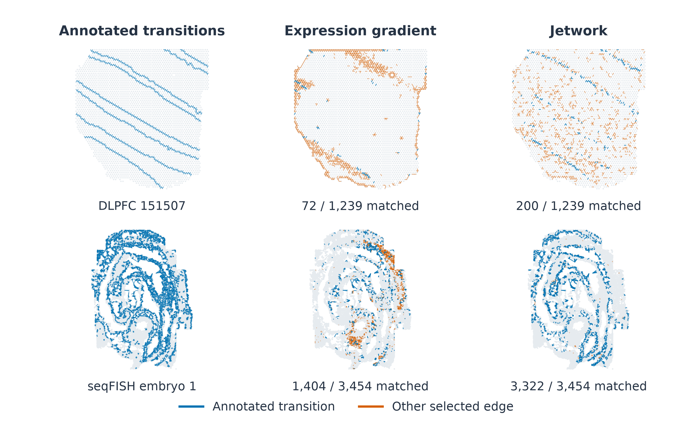

```{r setup, include = FALSE}
knitr::opts_chunk$set(message = FALSE, warning = FALSE, fig.width = 9, fig.height = 5, dpi = 110,
                      cache = FALSE)
```

# Overview

This vignette runs a standard Seurat spatial workflow and then adds juxtaposition analysis on top of it. It is written for bioinformaticians who will adapt it to their own sections, so each step says what it computes, which question it answers, and what to check before trusting the result.

The juxtaposed package provides two scores, and they answer **different questions**:

| Question | Score | Function | Reads |
|---|---|---|---|
| Do two programs meet at a tissue interface and change in *opposite* directions across it? | **Boundary J** | `juxtaposition()` | J > 0 opposing changes (an interface); J < 0 concordant changes; J ≈ 0 no shared boundary |
| *Where* is that interface? | **Edge map** | `score_edges()` → `edges_to_nodes()` | High signed evidence marks the edges where the pair changes in opposite directions |
| Are two genes expressed in the *same* neighbourhoods (co-expression, co-localization)? | **Regional J** | `regional_juxtaposition_matrix()` | > 0 shared region; < 0 complementary regions |

Boundary J is not a co-expression statistic. Two genes that are expressed in the same region rise and fall together across that region's edge, so boundary J is *negative* for them; that is correct, but it is the wrong instrument for the question "are these co-localized?". Use regional J for that question.

**Why boundary J and not Lee's L or bivariate Moran's I for interfaces?** Those statistics compare smoothed *levels*, so two complementary domains that touch and two that sit far apart can have nearly the same value. Boundary J compares *changes across the same edges*: it is positive only when the two domains actually meet. Its p-values come from an exact spectral sign-flip null on the tissue graph, so they are calibrated without permutations.

## Workflow at a glance

1. Start from a processed Seurat object (normalized data, clusters).
2. Build a spatial neighbour graph from the spot coordinates.
3. Score boundary J for all pairs of a gene panel, with spectral p- and q-values.
4. Map the interface of the top pairs with edge-level J.
5. Ask which clusters the interface separates.
6. Score co-localization with regional J and find co-localized modules.
7. Check calibration, robustness to the smoothing scale, and agreement across sections.
8. Fit Jetwork on independent sections and evaluate ranked edges against held-out annotations.
9. Export results and report them.

# Setup

## Installation

Run once. Seurat v5 (with hdf5r to read 10x files) and the juxtaposed package from this repository:

```{r install, eval = FALSE}
install.packages(c("Seurat", "hdf5r", "remotes", "ggplot2", "patchwork", "Matrix", "RANN", "dplyr", "tidyr"))

# juxtaposed (R >= 4.1; imports only Matrix, methods and stats)
remotes::install_github("son9john/Spatial_singlecell_DL", subdir = "J/r/juxtaposed", ref = "juxtaposition-index")

# Optional, faster SCTransform
install.packages("BiocManager"); BiocManager::install("glmGamPoi")
```

`RANN` is optional but recommended: `spatial_graph()` uses it for fast nearest-neighbour search and falls back to a dense distance matrix without it.

```{r libraries}
library(Seurat)
library(juxtaposed)
library(Matrix)
library(ggplot2)
library(patchwork)
library(dplyr)

# Default R (ggplot2) colours used throughout
col_opposing   <- "#F8766D"   # boundary J, opposing
col_regional   <- "#00BA38"   # regional J
col_concordant <- "#619CFF"   # concordant / comparators
col_ns         <- "#7F7F7F"
div_cols  <- c("#3A3A98", "#619CFF", "#F7F7F7", "#F8766D", "#832424")
expr_cols <- c("#F2F2F2", "#56B1F7", "#132B43")
set.seed(2021)
```

# Starting point: a processed Seurat object

J needs only two things from your object: a normalized, log-scale expression matrix and the spot coordinates. Any established preprocessing works, so this part is kept to the minimum; Seurat's own spatial vignette covers it in detail. We use the 10x Genomics sagittal mouse brain (anterior section 1), downloaded directly from 10x Genomics: the same files the companion Scanpy notebook reads. For your own data, point `Load10X_Spatial()` at the Space Ranger output folder.

```{r preprocess}
options(timeout = 900)
get_visium <- function(sample, dir = file.path("data", sample)) {
  base <- sprintf("https://cf.10xgenomics.com/samples/spatial-exp/1.1.0/%s/%s_", sample, sample)
  dir.create(dir, recursive = TRUE, showWarnings = FALSE)
  h5 <- file.path(dir, "filtered_feature_bc_matrix.h5")
  if (!file.exists(h5)) download.file(paste0(base, "filtered_feature_bc_matrix.h5"), h5, mode = "wb")
  if (!dir.exists(file.path(dir, "spatial"))) {
    tgz <- tempfile(fileext = ".tar.gz")
    download.file(paste0(base, "spatial.tar.gz"), tgz, mode = "wb")
    untar(tgz, exdir = dir)
  }
  Load10X_Spatial(dir, filename = "filtered_feature_bc_matrix.h5", slice = "slice1")
}
brain <- get_visium("V1_Mouse_Brain_Sagittal_Anterior")
brain <- SCTransform(brain, assay = "Spatial", verbose = FALSE)
brain <- RunPCA(brain, assay = "SCT", verbose = FALSE)
brain <- FindNeighbors(brain, reduction = "pca", dims = 1:30, verbose = FALSE)
brain <- FindClusters(brain, resolution = 0.8, verbose = FALSE)
brain <- RunUMAP(brain, reduction = "pca", dims = 1:30, verbose = FALSE)
```

```{r clusters, fig.height = 5}
DimPlot(brain, reduction = "umap", label = TRUE) + NoLegend() |
  SpatialDimPlot(brain, label = TRUE, label.size = 3) + NoLegend()
```

Before building the graph on your own data, remove spots outside the tissue and obvious artefacts: every edge of the graph enters J. Filtering on depth alone is not recommended in structured tissue, where depth varies with anatomy (white matter has fewer counts).

# Juxtaposition analysis

## Build the spatial graph

J is defined on a graph whose edges connect physically adjacent spots. On Visium, the six nearest neighbours reproduce the hexagonal lattice. Coordinates are read from the Seurat image, in the same order as the spots of the object.

```{r graph}
tissue_xy <- function(object, image = Images(object)[1]) {
  xy <- GetTissueCoordinates(object, image = image)
  xy <- xy[colnames(object)[colnames(object) %in% rownames(xy)], , drop = FALSE]
  num <- vapply(xy, is.numeric, logical(1))
  as.matrix(xy[, which(num)[1:2]])
}
xy <- tissue_xy(brain)
stopifnot(identical(rownames(xy), colnames(brain)))

G <- spatial_graph(xy, neighbors = 6)
deg <- Matrix::rowSums(G > 0)
table(degree = deg)
```

Most spots should have six neighbours; tissue edges have fewer. If the degree table is far from this (for example, many spots with more than six neighbours), check that the coordinates are spot centres in one consistent unit. For other platforms: use `neighbors = 6–10` for cell-level data (Xenium, MERFISH, CosMx), or `spatial_graph(xy, radius = r)` for a fixed physical radius.

## Choose the gene panel

All-pairs J scales with the square of the panel size. A panel of 100–500 genes is typical. Here: the 200 most variable SCT genes plus a few anatomical markers.

```{r panel}
markers <- c("Hpca", "Ttr", "Mbp", "Plp1", "Nrgn", "Calb2", "Pcp4", "Gfap", "Snap25", "Cck")
panel <- unique(c(head(VariableFeatures(brain), 200), markers))
panel <- intersect(panel, rownames(brain))

X <- t(as.matrix(GetAssayData(brain, assay = "SCT", layer = "data")[panel, colnames(brain)]))
X <- X[, apply(X, 2, sd) > 0]
dim(X)   # spots x genes
```

Use normalized, log-scale values (SCT `data`, or `LogNormalize` data). J is scale-free per gene, so the choice between them changes little; raw counts are not recommended because depth differences then create spurious shared edges.

## The spectral null, computed once

The null distribution of J depends only on the graph, not on the genes. Compute it once per section and reuse it for every test.

```{r null}
t0 <- Sys.time()
null <- spectral_null(G)
Sys.time() - t0
```

## Boundary J for all pairs

```{r juxtaposition}
res <- juxtaposition(X, G, null = null, scale = 1)
head(res, 10)
```

Each row is one unordered gene pair: `J` (effect size, between −1 and 1), `z` and `p` from the spectral sign-flip null, and Benjamini–Hochberg `q` over all pairs. `scale = 1` applies one step of graph smoothing before differencing, which suppresses spot-level noise; see the [robustness section](#robustness-to-the-smoothing-scale).

```{r volcano, fig.height = 5}
res <- res |>
  mutate(call = case_when(q < 0.05 & J > 0 ~ "opposing (interface)",
                          q < 0.05 & J < 0 ~ "concordant",
                          TRUE ~ "not significant"))
table(res$call)

ggplot(res, aes(J, -log10(pmax(q, 1e-300)), colour = call)) +
  geom_point(size = 0.8, alpha = 0.7) +
  scale_colour_manual(values = c("opposing (interface)" = col_opposing, "concordant" = col_concordant,
                                 "not significant" = col_ns)) +
  geom_hline(yintercept = -log10(0.05), linetype = 2, colour = col_ns) +
  labs(x = "boundary J", y = expression(-log[10]~q), colour = NULL,
       title = "All gene pairs", subtitle = "Right: pairs that change in opposite directions across the same edges") +
  theme_bw()
```

## The strongest interfaces

```{r top}
top_opposing <- res |> filter(q < 0.05, J > 0) |> arrange(desc(J)) |> head(15)
top_opposing
```

Positive J means that where one gene rises across an edge, the other falls: two complementary programs meeting along a boundary. A pair can be strongly anticorrelated overall and still have J ≈ 0 if its two domains never touch; that is the information Pearson's r and Lee's L do not carry.

## Map one interface

`score_edges()` computes a local J on every edge, pooled over the edges incident to its two endpoints. The settings below (lazy smoother, 4 steps, ridge 1) are those of the preprint's known-truth localization benchmark; `signed_evidence` ranks strong opposing transitions first and localized interfaces best there.

```{r edgemap, fig.width = 12, fig.height = 4.5}
pair <- c(top_opposing$feature_x[1], top_opposing$feature_y[1])
pair

edges <- score_edges(X[, pair], G, scale = 4L, ridge = 1, smoother = "lazy")
brain$interface <- edges_to_nodes(edges, ncol(brain), field = "signed_evidence")
brain$local_J   <- edges_to_nodes(edges, ncol(brain), field = "j")

lim <- max(abs(brain$interface), na.rm = TRUE)
(SpatialFeaturePlot(brain, features = pair[1]) + scale_fill_gradientn(colours = expr_cols)) |
  (SpatialFeaturePlot(brain, features = pair[2]) + scale_fill_gradientn(colours = expr_cols)) |
  (SpatialFeaturePlot(brain, features = "interface") +
     scale_fill_gradientn(colours = div_cols, limits = c(-lim, lim), name = "signed\nevidence"))
```

Red spots lie on edges where the two genes change in opposite directions: the interface between their domains.

## Which clusters does the interface separate?

For each pair of adjacent clusters, the mean signed evidence on the edges that cross between them. The top rows are the annotated boundaries the interface runs along; compare them with anatomy or with your cell-type annotation.

```{r interface_clusters}
cl <- as.character(Idents(brain))
edges |>
  mutate(a = cl[from], b = cl[to]) |>
  filter(a != b) |>
  mutate(boundary = paste(pmin(a, b), pmax(a, b), sep = " | ")) |>
  group_by(boundary) |>
  summarise(edges = n(), mean_evidence = mean(signed_evidence), .groups = "drop") |>
  filter(edges >= 10) |>
  arrange(desc(mean_evidence)) |>
  head(10)
```

## Concordant pairs

Negative J means the two genes change in the same direction across the same edges: they share a boundary on the same side. Expect anatomical markers of one region here.

```{r concordant}
res |> filter(q < 0.05, J < 0) |> arrange(J) |> head(10)
```

# Co-localization with regional J

For "are these genes expressed in the same neighbourhoods?", use regional J. It averages an edge-sum concordance over graph scales 1, 2, 4, 8 and 16 steps, so it rewards shared regions at several sizes. It returns a score without a p-value.

```{r regional, fig.width = 8, fig.height = 7.5}
genes50 <- head(intersect(c(markers, VariableFeatures(brain)), colnames(X)), 50)
R <- regional_juxtaposition_matrix(X[, genes50], G)
dimnames(R) <- list(genes50, genes50)

ord <- hclust(as.dist(1 - R), method = "average")$order
long <- expand.grid(x = genes50[ord], y = genes50[ord], stringsAsFactors = FALSE)
long$v <- R[cbind(long$y, long$x)]
ggplot(long, aes(factor(x, genes50[ord]), factor(y, rev(genes50[ord])), fill = v)) +
  geom_tile() + coord_equal() +
  scale_fill_gradientn(colours = div_cols, limits = c(-1, 1), name = "regional J") +
  labs(x = NULL, y = NULL, title = "Regional J: shared neighbourhood expression") +
  theme_minimal(base_size = 9) + theme(axis.text.x = element_text(angle = 90, hjust = 1, vjust = 0.5))
```

## Co-localized modules

```{r modules}
modules <- cutree(hclust(as.dist(1 - R), method = "average"), h = 0.6)
split(names(modules), modules)[lengths(split(names(modules), modules)) > 1]
```

Each module is a set of genes that occupy the same neighbourhoods. Module scores (`AddModuleScore`) can then be mapped and compared across samples.

# How boundary J relates to the established statistics

`compare_indices()` returns J, Lee's L, bivariate Moran's I, Pearson's r and negative codispersion on the same graph.

```{r compare, fig.height = 4.5}
cmp <- compare_indices(X[, genes50], G)
ggplot(cmp, aes(lee_L, J)) +
  geom_hline(yintercept = 0, colour = col_ns) + geom_vline(xintercept = 0, colour = col_ns) +
  geom_point(size = 0.9, alpha = 0.6, colour = col_concordant) +
  labs(x = "Lee's L (level co-localization)", y = "boundary J (opposing change across edges)") +
  theme_bw()
```

They answer different questions, so they are not expected to agree. Pairs with strongly negative L and J near zero are complementary but do not touch; pairs with J > 0 are complementary *and* meet at an interface.

# Checks before reporting

## Calibration on scrambled tissue

Permuting each gene's values over the spots, independently for each gene, destroys all spatial structure and all dependence between genes, so the p-values should then be uniform. Permute genes independently: permuting whole spots keeps the genes' ordinary correlation, and correlated genes do change together across edges, so those pairs are correctly called.

```{r calibration, fig.height = 4}
Xperm <- apply(X[, 1:60], 2, sample)
pp <- juxtaposition(Xperm, G, null = null, scale = 1)$p
c(prop_p_below_0.05 = mean(pp < 0.05))
ggplot(data.frame(p = pp), aes(p)) + geom_histogram(breaks = seq(0, 1, 0.05), fill = col_concordant, colour = "white") +
  labs(title = "p-values on scrambled tissue (should be flat)") + theme_bw()
```

## Robustness to the smoothing scale

```{r robustness}
scales_tested <- 0:3
Js <- sapply(scales_tested, function(s) {
  r <- juxtaposition(X[, genes50], G, scale = s, test = FALSE)
  r <- r[order(r$feature_x, r$feature_y), ]
  r$J
})
colnames(Js) <- paste0("scale_", scales_tested)
round(cor(Js, method = "spearman"), 3)
```

High rank correlations mean the conclusions do not hinge on the smoothing choice. Report the scale you used.

## Replication across sections

Run the same analysis on a second section and combine per-pair z-scores with Stouffer's method. Pairs called on one section only deserve caution.

```{r replicate}
run_section <- function(type) {
  obj <- get_visium(type)
  obj <- SCTransform(obj, assay = "Spatial", verbose = FALSE)
  g <- spatial_graph(tissue_xy(obj), neighbors = 6)
  genes <- intersect(colnames(X), rownames(obj[["SCT"]]))
  x <- t(as.matrix(GetAssayData(obj, assay = "SCT", layer = "data")[genes, colnames(obj)]))
  x <- x[, apply(x, 2, sd) > 0]
  juxtaposition(x, g, scale = 1)
}
res2 <- run_section("V1_Mouse_Brain_Sagittal_Anterior_Section_2")
both <- inner_join(res, res2, by = c("feature_x", "feature_y"), suffix = c("_1", "_2")) |>
  mutate(z_combined = (z_1 + z_2) / sqrt(2),
         p_combined = 2 * pnorm(-abs(z_combined)),
         q_combined = p.adjust(p_combined, "BH"))
c(J_correlation = cor(both$J_1, both$J_2, use = "complete.obs"))
both |> filter(q_combined < 0.05, J_1 > 0, J_2 > 0) |> arrange(desc(z_combined)) |>
  select(feature_x, feature_y, J_1, J_2, z_combined, q_combined) |> head(10)
```

Stouffer's combination assumes independent sections. For serial sections of one animal, treat the combined value as descriptive.

# Jetwork: rank tissue boundaries {#jetwork}

Jetwork learns which genes rise and fall together within a region and which genes change in opposite directions across tissue edges. Apply the fitted network to a new section to **rank candidate interface edges** or nominate partners for a set of marker genes. If the new section has annotations, compare the predicted edges with the edges that connect different labels.

In the exploratory seqFISH benchmark, adding Jetwork to an expression-gradient model raised mean average precision from 0.446 to 0.704 and top-10% Jaccard from 0.122 to 0.274 across three held-out embryos. The same addition changed average precision little in DLPFC and MERFISH. The seqFISH reference measures recovery of published cell-type annotations, which were informed by expression and anatomy. [SeqFISH annotation methods](https://www.nature.com/articles/s41587-021-01006-2)

## Fit the gene network on training sections

Save [jetwork.R](jetwork.R) beside the vignette so that R can load the helpers. Each training section supplies an expression matrix with sites in rows and genes in columns, a spatial graph in the same site order, and a biological group ID. Group serial sections by donor or animal. Choose the gene panel on training data and fit the network before using the held-out section.

This example uses three **simulated** sections with known labels. It uses the same functions that will accept your own Seurat data.

```{r jetwork-fit}
helper <- "jetwork.R"
if (!file.exists(helper)) helper <- "J/site/vignettes/jetwork.R"
source(helper)

make_section <- function(group, seed) {
  set.seed(seed)
  spots <- expand.grid(col = 0:23, row = 0:17)
  ids <- paste(group, seq_len(nrow(spots)), sep = "_")
  xy <- cbind(x = spots$col + (spots$row %% 2) / 2, y = spots$row * sqrt(3) / 2)
  rownames(xy) <- ids
  region <- ifelse(spots$col < 12, "Left", "Right")
  shift <- plogis((spots$col - 11.5) * 1.4)
  nuisance <- pmax(0, sin(spots$row / 1.5))
  x <- cbind(Left1 = 2 - 1.6 * shift, Left2 = 1.8 - 1.3 * shift,
             Right1 = 0.5 + 1.5 * shift, Right2 = 0.6 + 1.3 * shift,
             Gradient1 = 1 + 2 * nuisance, Gradient2 = 1.2 + 2.1 * nuisance)
  x <- x + matrix(rnorm(length(x), sd = 0.22), nrow = nrow(x))
  rownames(x) <- ids
  g <- juxtaposed::visium_graph(spots$row, 2 * spots$col + spots$row %% 2)
  dimnames(g) <- list(ids, ids)
  list(expression = x, graph = g, group = group, annotation = setNames(region, ids), xy = xy)
}
training <- list(make_section("train_A", 101), make_section("train_B", 102))
held_out <- make_section("test_C", 103)

network <- fit_jetwork(training)
head(rank_jetwork_genes(network, c("Left1", "Left2")))
```

## Score and validate a held-out section

Generate predictions without the test labels. If training annotations are available, fit two binomial models on the same training edges. One uses the expression gradient and the other adds Jetwork. Compare both at the same prediction budget.

```{r jetwork-evaluate}
edges <- score_jetwork_edges(network, held_out$expression, held_out$graph)

training_edges <- do.call(rbind, lapply(training, function(s) {
  e <- score_jetwork_edges(network, s$expression, s$graph)
  e$transition <- jetwork_edge_truth(e, s$annotation)
  e
}))
gradient_model <- glm(transition ~ gradient, data = training_edges, family = binomial())
jetwork_model <- glm(transition ~ gradient + jetwork, data = training_edges, family = binomial())
edges$gradient_fit <- predict(gradient_model, newdata = edges, type = "response")
edges$gradient_jetwork <- predict(jetwork_model, newdata = edges, type = "response")

rbind(
  evaluate_jetwork_edges(edges, held_out$annotation, score = "gradient_fit", top = 0.10),
  evaluate_jetwork_edges(edges, held_out$annotation, score = "gradient_jetwork", top = 0.10)
)
```

Average precision measures how well the scores move annotated transitions toward the top. Jaccard is the overlap between the selected edges and all eligible annotated transitions, divided by the size of their union. Compare average precision with the transition prevalence. Annotations are joined by site ID, and edges with a missing label are omitted from evaluation.

```{r jetwork-map, fig.width = 8, fig.height = 3.75}
edge_map <- function(selected, title, colour) {
  a <- held_out$xy
  plot(a, asp = 1, pch = 16, cex = .45, col = "#d8dde4", xlab = "", ylab = "",
       axes = FALSE, main = title)
  segments(a[edges$i[selected], 1], a[edges$i[selected], 2],
           a[edges$j[selected], 1], a[edges$j[selected], 2], col = colour, lwd = 1.5)
}
known <- jetwork_edge_truth(edges, held_out$annotation)
top <- head(order(-edges$gradient_jetwork, edges$i, edges$j), ceiling(.10 * nrow(edges)))
old_par <- par(mfrow = c(1, 2), mar = c(1, 1, 3, 1))
edge_map(which(known), "Annotated transitions", "#0072B2")
edge_map(top, "Top 10% of predicted edges", ifelse(known[top], "#0072B2", "#D55E00"))
par(old_par)
```

Blue predicted edges match annotated transitions. Orange edges are other predictions. On an unannotated section, use the rankings to prioritise regions for inspection. The network score and fitted edge probabilities are predictions. Boundary J's pair-level spectral test applies to individual gene pairs.

## Real data: seqFISH embryo 1 {#seqfish-embryo-1}

In the bottom row of **Figure S6 from the manuscript**, the left panel shows edges between different annotated cell types in embryo 1. The middle and right panels show the top 10% ranked by the expression gradient and Jetwork, respectively. At the same budget of 3,454 edges, the gradient matched **1,404** annotated transitions and Jetwork matched **3,322**. The gene network was fitted on embryos 2 and 3. Embryo 1's labels were used only to evaluate its ranked edges.

```{r jetwork-seqfish-figure, echo = FALSE, out.width = "100%", fig.alt = "Figure S6. The seqFISH embryo 1 panels show annotated transitions, 1,404 matches for the expression gradient, and 3,322 matches for Jetwork at a shared budget of 3,454 edges.", fig.cap = "Manuscript Figure S6. The top row shows DLPFC section 151507 and the bottom row shows seqFISH embryo 1. Blue indicates an annotated transition in the reference panel or a match in a prediction panel. Orange marks other selected edges."}

```

The figure compares the two scores individually. In the cohort benchmark above, Jetwork was added to the gradient model. The annotations were informed by expression and anatomy, so a match means agreement with the published cell-type labels. [SeqFISH study and data](https://www.nature.com/articles/s41587-021-01006-2)

To reproduce the comparison from prepared data, pass one measured slice per embryo with the shared 351-gene expression panel, a symmetric six-nearest-neighbour graph and named site annotations. Use the same input format as the simulated example.

```{r jetwork-seqfish-reproduce, eval = FALSE}
seqfish_network <- fit_jetwork(list(embryo2, embryo3))
seqfish_edges <- score_jetwork_edges(seqfish_network, embryo1$expression, embryo1$graph)

rbind(
  evaluate_jetwork_edges(seqfish_edges, embryo1$annotation, score = "gradient", top = 0.10),
  evaluate_jetwork_edges(seqfish_edges, embryo1$annotation, score = "jetwork", top = 0.10)
)
```

## Use your own Seurat objects

Use one Seurat object per section and keep every section from the test donor or animal out of training. This example assumes normalized values in the `SCT` assay's `data` layer and a metadata column named `domain`. Use your assay and annotation names as needed.

```{r jetwork-seurat-adapter, eval = FALSE}
# Replace these with your training and held-out Seurat objects.
train_objects <- list(donor_A = section_A, donor_B = section_B)
test_object <- section_C

# Use training variable features measured in all training sections.
training_features <- lapply(train_objects, function(obj) rownames(obj[["SCT"]]))
shared <- Reduce(intersect, training_features)
panel <- head(intersect(VariableFeatures(train_objects[[1]], assay = "SCT"), shared), 512)

as_jetwork_section <- function(object, group, genes, label = "domain") {
  coords <- tissue_xy(object)
  stopifnot(identical(rownames(coords), colnames(object)))
  expr <- GetAssayData(object, assay = "SCT", layer = "data")
  missing_genes <- setdiff(genes, rownames(expr))
  if (length(missing_genes)) stop("Missing panel genes: ", paste(missing_genes, collapse = ", "))
  x <- t(as.matrix(expr[genes, rownames(coords), drop = FALSE]))
  g <- spatial_graph(coords, neighbors = 6)
  dimnames(g) <- list(rownames(coords), rownames(coords))
  tags <- if (label %in% colnames(object[[]])) {
    setNames(as.character(object[[]][rownames(coords), label]), rownames(coords))
  } else {
    NULL
  }
  list(expression = x, graph = g, group = group, annotation = tags, xy = coords)
}

training <- Map(as_jetwork_section, train_objects, names(train_objects),
                MoreArgs = list(genes = panel))
held_out <- as_jetwork_section(test_object, "donor_C", panel)
network <- fit_jetwork(training)
edges <- score_jetwork_edges(network, held_out$expression, held_out$graph)
if (!is.null(held_out$annotation)) evaluate_jetwork_edges(edges, held_out$annotation)
write.csv(edges, "held_out_jetwork_edges.csv", row.names = FALSE)
saveRDS(network, "jetwork_gene_network.rds")
```

For Visium with available array rows and columns, use `visium_graph(array_row, array_col)` for the native hexagonal topology. For multiple sections per donor, pass the same biological group ID. To review proposed marker partners, call `rank_jetwork_genes()` with anchor genes from the fitted panel.

# Export

```{r export, eval = FALSE}
write.csv(res, "boundary_J_all_pairs.csv", row.names = FALSE)
write.csv(R, "regional_J_matrix.csv")
saveRDS(list(graph = G, null = null), "anterior1_graph_and_null.rds")   # reuse the null later
saveRDS(brain, "anterior1_with_interface.rds")
```

The Python package (`pip install` from `J/python` in the repository) gives the same numbers from AnnData with `juxtaposed.from_anndata()`.

# Reporting checklist

- Graph: construction (k nearest neighbours or radius), *k*, and the degree distribution.
- Expression values: assay and normalization.
- Panel: how genes were chosen, and the number of pairs tested.
- Score and question: boundary J for interfaces; regional J for co-localization.
- Scale (smoothing steps) for boundary J, and the robustness check.
- Inference: spectral sign-flip null (normal approximation), two-sided, with Benjamini–Hochberg q over all pairs tested.
- Edge maps: `score_edges()` settings (smoother, scale, ridge) and the field shown.
- Replication across sections, if available.

**Methods sentence you can adapt.** "Spot adjacency was defined by the six nearest neighbours on the Visium lattice. For each gene pair, the juxtaposition index J (juxtaposed v0.4.0) was computed after one step of graph smoothing, and two-sided p-values were obtained from the spectral sign-flip null of the tissue graph (normal approximation), with Benjamini–Hochberg correction over all pairs. Interfaces were mapped with edge-level J (lazy smoother, four steps, ridge 1). Co-localization was assessed with regional J over graph scales 1–16."

# Session information

```{r session}
sessionInfo()
```
